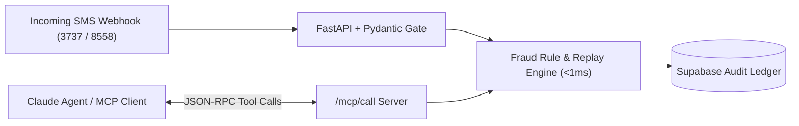

# Claude MCP Fraud Ops (`claude-mcp-fraud-ops`)

An **Anthropic Model Context Protocol (MCP) Server** and **FastAPI Real-Time Fraud Triage Engine** built for instant verification of mobile wallet receipts (Easypaisa `3737` / JazzCash `8558`), replay-attack prevention, and Supabase audit logging.

## Key Capabilities

1. **Model Context Protocol (MCP) Tool Server (`/mcp/tools` & `/mcp/call`):**
   - Exposes 4 structured JSON-Schema tools directly callable by **Anthropic Claude**, **Claude Code**, or local LLM agents:
     - `verify_payment_sms`: Parses raw SMS webhooks and detects sender spoofing, TID replay attacks, and decimal amount tampering in `< 1 ms`.
     - `query_ledger_stats`: Returns live verification vs. fraud block rates.
     - `check_duplicate_tx`: Checks whether a Transaction ID (`TID`/`Trx ID`) has already been redeemed.
     - `list_flagged_incidents`: Streams blocked high-risk payment attempts with structured AI triage summaries.
2. **Deterministic + Agentic Triage Architecture:**
   - Never trusts raw LLM arithmetic on currency values; enforces strict regex/Pydantic schema validation first and produces a human-readable audit trail for operators.
3. **Zero-Config Live Dashboard (`GET /`):**
   - Built-in dark-mode monitoring dashboard showing real-time fraud block rates and sub-millisecond latency metrics.

## Quickstart

```bash
# Run unit tests
pytest

# Launch the FastAPI + MCP server
uvicorn mcp_fraud_ops.server:app --reload --app-dir src
```

## Architecture


